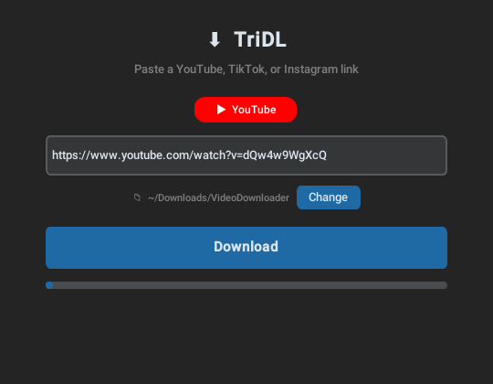

# TriDL

A small desktop app for downloading videos from **TikTok**, **YouTube** and **Instagram**. Paste a link, hit Download, done.

<p align="center">
  
</p>

## Features

- **One box for all three platforms.** TriDL works out which site a link is from and shows it as you paste.
- **TikTok without the watermark**
- **YouTube in MP4**, with the best video and audio merged into one file
- **Instagram** reels and video posts
- **Pick your save folder**, or use the default `~/Downloads/VideoDownloader`
- **Dark mode UI** built with [CustomTkinter](https://github.com/TomSchimansky/CustomTkinter)

## Download

Grab the latest build from the [**Releases page**](../../releases/latest). No setup needed, just download and run.

## Run from source

You'll need Python 3.10+ and [FFmpeg](https://ffmpeg.org/download.html) on your `PATH`. FFmpeg is what merges YouTube's separate video and audio streams.

```bash
git clone https://github.com/kevin11dev/TriDL.git
cd TriDL
pip install -r requirements.txt
python app.py
```

On Linux you may also need Tk: `sudo apt install python3-tk` on Debian/Ubuntu.

## How it works

1. Copy a video link from TikTok, YouTube or Instagram
2. Paste it into TriDL. The badge shows which platform it detected.
3. Click **Download**

The actual downloading is done by [yt-dlp](https://github.com/yt-dlp/yt-dlp). TriDL is a friendly front end for it.

## Troubleshooting

- **Download fails on a link that used to work:** the sites change things often. Update yt-dlp with `pip install -U yt-dlp`.
- **YouTube video has no sound, or fails to merge:** make sure FFmpeg is installed and on your `PATH`.
- **Private or age-restricted content** won't download, because TriDL doesn't log in to any account.

## Disclaimer

For personal and educational use. Only download content you have the right to, and respect the terms of service of TikTok, YouTube and Instagram.

## License

[MIT](LICENSE). Use it, change it, share it. Just keep the copyright notice.

---

If TriDL saved you some time, a ⭐ is always appreciated.
